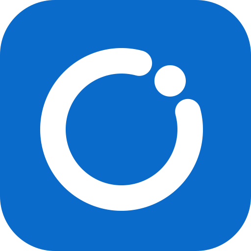
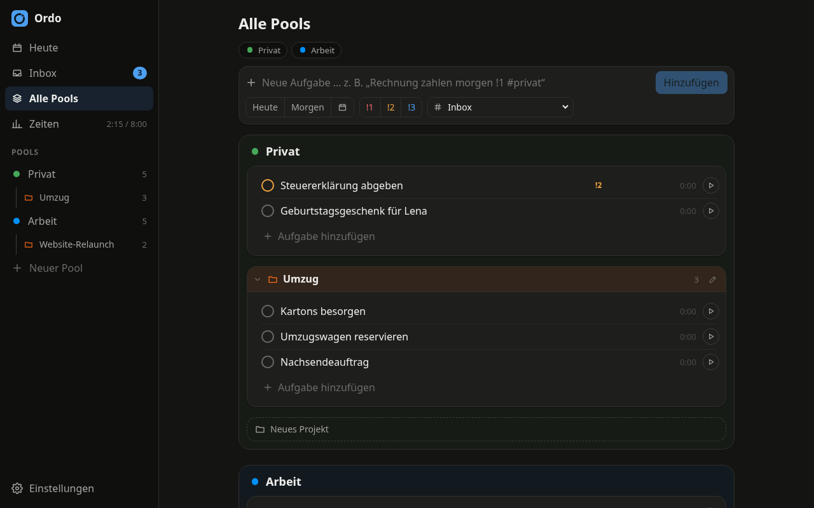
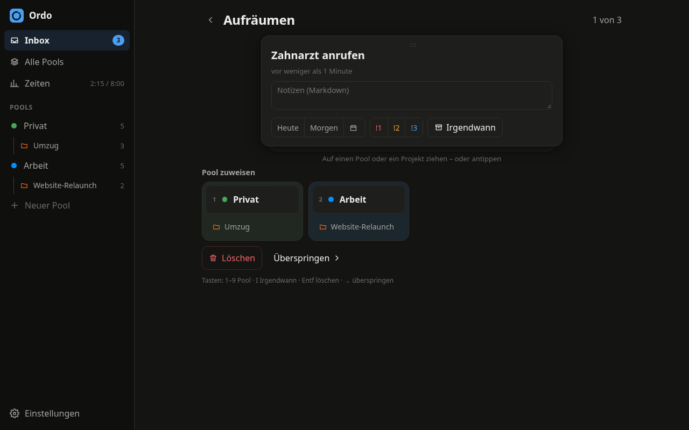
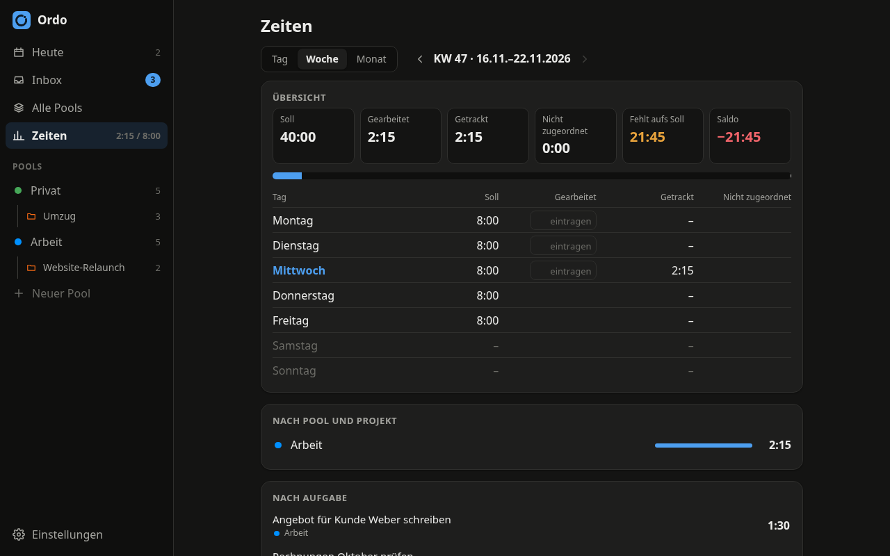

<p align="center">
  
</p>

<h1 align="center">Ordo</h1>

<p align="center">
  Aufgaben in Ordnung – lokal auf deinen Geräten, synchronisiert über deinen eigenen CalDAV-Server.
</p>

<p align="center">
  
</p>

**Ordo** (lateinisch „Ordnung“) ist eine Aufgaben-App, die zuerst auf dem Gerät arbeitet
(_local-first_): Alles funktioniert offline und sofort, ohne Konto und ohne Cloud.
Wer mehrere Geräte nutzt, verbindet einen eigenen CalDAV-Server (z. B. Radicale oder
Nextcloud). Die Aufgaben bleiben dabei normale VTODOs und sind auch mit Tasks.org,
DAVx⁵ oder Thunderbird lesbar.

## Was Ordo kann

- **Pools** – getrennte Bereiche wie _Privat_ und _Arbeit_, jeweils mit eigener Farbe, eigenem
  Icon und eigenem Sync-Ziel. Darin **Projekte** und beliebig tief verschachtelte **Unteraufgaben**.
- **Schnelleingabe** – `Angebot schreiben morgen 9:00 !1 #arbeit` legt die Aufgabe mit Datum,
  Uhrzeit, Priorität und Pool an. Erkannte Teile erscheinen als Chips.
- **Outliner** – Enter, Tab, Pfeiltasten wie in einer Gliederung; Ziehen mit Maus oder Finger.
- **Inbox und Aufräumen** – alles landet erst in der Inbox. Beim **Aufräumen** liegt jede
  Aufgabe als Karte da und wird auf einen Pool gezogen. Auf Wunsch zu festen Zeiten
  **vorgeschlagen oder erzwungen**.
- **Zurückschieben statt verstecken** – mit Zähler; wer etwas zum dritten Mal schiebt, wird gefragt.
- **Zeiterfassung** (zuschaltbar) – Play-Knopf oder Eingabe wie `0,5h`, Soll-Zeit je Wochentag,
  Auswertung nach Tag, Woche und Monat.
- **CalDAV-Sync** – mehrere Konten, Zusammenführung pro Feld, echte Konflikte zum Auswählen.
- **PWA** – installierbar auf Handy und PC, startet offline.
- **Anpassbar** – helles/dunkles Farbschema, Akzentfarbe, Dichte, Schriftgröße.

<p align="center">
  
  
</p>

## Schnellstart

**Auf Proxmox** – ein Befehl in der Shell des Proxmox-Hosts legt einen kleinen Container mit
App und CalDAV-Server an:

```bash
bash -c "$(curl -fsSL https://raw.githubusercontent.com/bischofone/tasks-app/main/install/proxmox.sh)"
```

**Lokal ausprobieren:**

```bash
git clone https://github.com/bischofone/tasks-app.git ordo
cd ordo
pnpm install
pnpm dev
```

Dann <http://localhost:5173> öffnen. Mehr dazu – Docker, eigene Domain, Installation am Handy:
**[Installationsanleitung](docs/INSTALLATION.md)**.

## Dokumentation

| Dokument                              | Für wen                                                             |
| ------------------------------------- | ------------------------------------------------------------------- |
| [Installation](docs/INSTALLATION.md)  | App starten, auf eigenem Server betreiben, auf Geräten installieren |
| [Bedienung](docs/BEDIENUNG.md)        | Alle Funktionen, Tastenkürzel und Eingabeformate                    |
| [Server mit Docker](docker/README.md) | Radicale + Caddy mit HTTPS in wenigen Schritten                     |
| [Architektur](docs/ARCHITEKTUR.md)    | Wie der Code aufgebaut ist: Daten, Zustand, Sync, Oberfläche        |
| [Entwicklung](docs/ENTWICKLUNG.md)    | Befehle, Tests, Konventionen, neue Funktionen einbauen              |
| [SPEC.md](SPEC.md)                    | Die vollständige Spezifikation und alle Entscheidungen              |
| [CHANGELOG.md](CHANGELOG.md)          | Was sich wann geändert hat                                          |

## Stand

| Phase | Inhalt                                                    | Status    |
| ----- | --------------------------------------------------------- | --------- |
| 1     | Lokale App: Pools, Outliner, Schnelleingabe, Inbox, PWA   | ✅ fertig |
| 2     | CalDAV-Sync pro Pool, Radicale-Server mit Docker          | ✅ fertig |
| –     | Zeiterfassung (aus Phase 5 vorgezogen)                    | ✅ fertig |
| 3     | Android-App (Capacitor), Benachrichtigungen, Kontext-Modi | geplant   |
| 4     | Planung: „Was als Nächstes?“, Heute-Ansicht, Tagesplanung | geplant   |
| 5     | Wartet-auf, Abhängigkeiten, Wiederholungen, Vorlagen      | geplant   |
| 6     | KI über OpenRouter, strikt getrennt pro Pool              | geplant   |
| 7     | Wochenrückblick, Export/Backup, Desktop-App               | geplant   |

## Technik in einem Satz

SvelteKit 3 als reine Browser-App (Svelte 5, TypeScript), Daten in IndexedDB über Dexie,
eigener CalDAV-Client mit ical.js, getestet mit Vitest und Playwright.
Details in der [Architektur](docs/ARCHITEKTUR.md).
