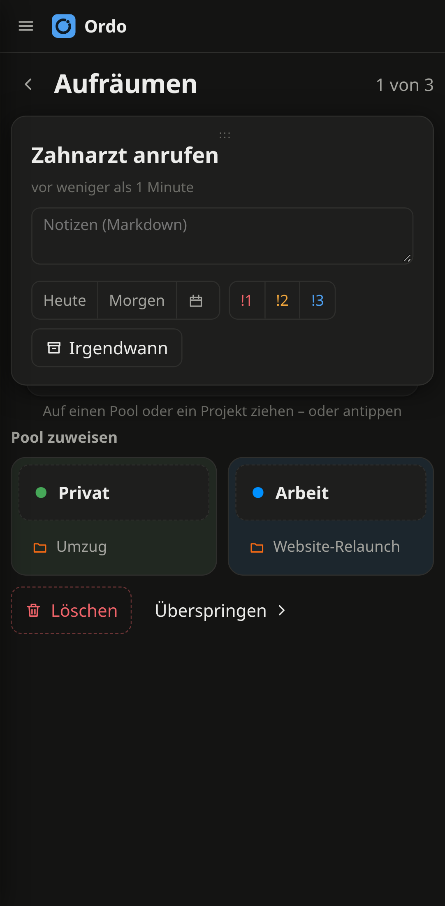
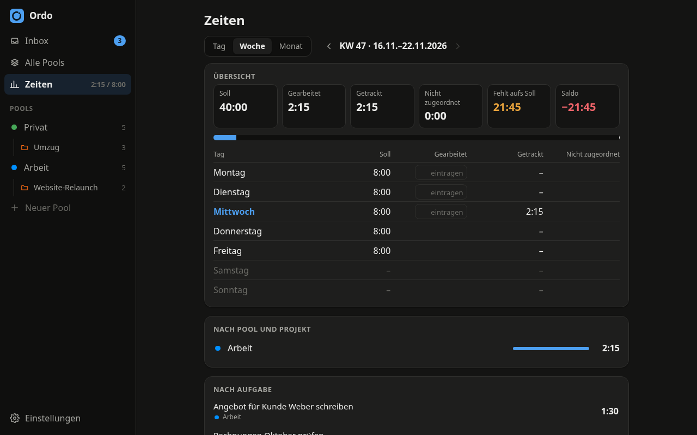

# Bedienung

Alles, was Ordo kann – mit Tastenkürzeln und Eingabeformaten zum Nachschlagen.

- [Grundbegriffe](#grundbegriffe)
- [Aufgaben anlegen: die Schnelleingabe](#aufgaben-anlegen-die-schnelleingabe)
- [Arbeiten in der Liste (Outliner)](#arbeiten-in-der-liste-outliner)
- [Details einer Aufgabe](#details-einer-aufgabe)
- [Zurückschieben, Später, Irgendwann](#zurückschieben-später-irgendwann)
- [Inbox und Aufräumen](#inbox-und-aufräumen)
- [Zeiterfassung](#zeiterfassung)
- [Synchronisation](#synchronisation)
- [Einstellungen](#einstellungen)
- [Am Handy](#am-handy)
- [Alle Tastenkürzel](#alle-tastenkürzel)

---

## Grundbegriffe

| Begriff     | Bedeutung                                                                                                                  |
| ----------- | -------------------------------------------------------------------------------------------------------------------------- |
| **Pool**    | Ein getrennter Lebensbereich, z. B. _Privat_ oder _Arbeit_. Jeder Pool hat Farbe, Icon und optional ein eigenes Sync-Ziel. |
| **Projekt** | Eine Gruppe innerhalb eines Pools, z. B. _Umzug_. Eine Ebene tief.                                                         |
| **Aufgabe** | Kann beliebig viele Unteraufgaben haben, in beliebiger Tiefe.                                                              |
| **Inbox**   | Sammelstelle für alles, was noch keinem Pool zugeordnet ist.                                                               |

In der Seitenleiste stehen **Inbox**, **Alle Pools** (alle Pools untereinander),
die einzelnen Pools mit ihren Projekten, **Zeiten** (bei eingeschalteter Zeiterfassung)
und die **Einstellungen**. Zahlen daneben zeigen offene Aufgaben.

---

## Aufgaben anlegen: die Schnelleingabe

Oben in jeder Ansicht. Text eintippen, Enter – fertig. Bestimmte Wörter werden erkannt
und erscheinen als Chips unter dem Feld:

| Eingabe                         | Bedeutung                                        |
| ------------------------------- | ------------------------------------------------ |
| `heute`, `morgen`, `übermorgen` | Fälligkeitsdatum                                 |
| `Montag` … `Sonntag`            | der nächste solche Wochentag                     |
| `15.12.` oder `15.12.2026`      | festes Datum                                     |
| `9:00` oder `9:00 Uhr`          | Uhrzeit                                          |
| `!1` `!2` `!3`                  | Priorität (1 = hoch)                             |
| `#arbeit`                       | Pool (Anfang des Namens reicht, Groß/klein egal) |
| `#umzug` oder `#privat/umzug`   | Projekt                                          |

**Beispiel:** `Rechnung zahlen morgen 9:00 !1 #privat`

- Ein Chip mit ✕ macht das Erkannte wieder zu normalem Titeltext
  (z. B. wenn „Montag“ wirklich im Titel stehen soll).
- Dasselbe geht per Klick mit den Knöpfen darunter: **Heute / Morgen / Datum**, **!1–!3**
  und die Auswahl **Pool / Projekt**.
- Gibt es einen `#pool` noch nicht, bietet der Chip an, ihn anzulegen.
- Ohne Angabe landet die Aufgabe in dem Pool oder Projekt, das gerade offen ist.

---

## Arbeiten in der Liste (Outliner)

Die Liste funktioniert wie eine Gliederung – schnell und nur mit der Tastatur:

| Taste                         | Wirkung                                         |
| ----------------------------- | ----------------------------------------------- |
| **Enter**                     | neue Aufgabe darunter                           |
| **Tab**                       | einrücken (wird Unteraufgabe der Zeile darüber) |
| **Shift+Tab**                 | ausrücken                                       |
| **↑ / ↓**                     | zur Zeile darüber / darunter                    |
| **Alt+↑ / Alt+↓**             | Zeile verschieben                               |
| **Strg+Enter**                | erledigt / wieder offen                         |
| **Backspace** in leerer Zeile | Zeile löschen                                   |
| **Escape**                    | Bearbeiten beenden                              |

Tippst du sehr schnell weiter, nachdem du Enter gedrückt hast, geht trotzdem nichts verloren.

**Weitere Bedienung mit der Maus:**

- **Häkchen-Kreis** – erledigt. Die Farbe des Kreises zeigt die Priorität.
- **↳-Knopf** (beim Drüberfahren) – Unteraufgabe anlegen.
- **Pfeil links** – Unteraufgaben auf- und zuklappen. Rechts steht der Fortschritt, z. B. `1/3`.
- **Ziehen am Griff** links der Zeile (erscheint beim Drüberfahren): hoch/runter ändert die
  Reihenfolge, nach links/rechts die Ebene. Auf einen Pool oder ein Projekt in der
  Seitenleiste ziehen verschiebt die Aufgabe dorthin.
- **Projekte:** im Pool unten **„Neues Projekt“**. Name, Farbe und Icon über den Stift-Knopf.
- Löschen lässt sich über **„Rückgängig“** im Hinweis unten zurücknehmen.

---

## Details einer Aufgabe

Klick auf eine Aufgabe öffnet ihre Details: am PC rechts neben der Liste, am Handy als
Blatt von unten (dort neben den Titel tippen). Darin:

- **Notizen** in Markdown (Vorschau und Bearbeiten umschaltbar)
- **Fällig** und **Geplant** (Datum, optional Uhrzeit), **Priorität**
- **Pool und Projekt** ändern
- Unteraufgaben, Zurückschieben, Irgendwann, Löschen
- **Zeit** (bei eingeschalteter Zeiterfassung): Einträge ansehen, hinzufügen, ändern

Wer lieber direkt in den Titel klickt, um ihn zu bearbeiten, schaltet das in
**Einstellungen → Darstellung → „Details beim Anklicken öffnen“** aus.

---

## Zurückschieben, Später, Irgendwann

- **Zurückschieben** (Uhr-Knopf an der Zeile, oder am Handy nach links wischen):
  _Morgen_, _Nächste Woche_, _Nächster Monat_ oder ein eigenes Datum. Die Aufgabe rutscht in
  den Bereich **„Später“** und kommt am gewählten Tag von selbst zurück.
- Ordo zählt mit, wie oft etwas verschoben wurde. **Beim dritten Mal fragt es nach:**
  aufteilen, nach „Irgendwann“ legen oder löschen?
- **Irgendwann** ist die Ablage für „vielleicht mal“. Diese Aufgaben stehen eingeklappt
  unten im Pool und stören nicht.
- **Erledigt** steht ebenfalls eingeklappt unten.

---

## Inbox und Aufräumen

Die Inbox sammelt alles, was schnell notiert und noch nicht einsortiert ist.
Einträge, die zu lange liegen, werden hervorgehoben (Anzahl Tage einstellbar).

### Aufräumen

**Inbox → „Aufräumen“** zeigt die Einträge einzeln als Karte:

1. Auf der Karte direkt **Titel, Notiz, Fälligkeit, Priorität** oder **Irgendwann** setzen.
2. Die Karte auf einen **Pool oder ein Projekt ziehen** – oder die Kachel antippen.
3. Die nächste Karte kommt.

| Geste / Taste                            | Wirkung             |
| ---------------------------------------- | ------------------- |
| auf eine Kachel ziehen / tippen          | dorthin verschieben |
| auf „Löschen“ ziehen, nach links wischen | löschen             |
| nach rechts wischen                      | überspringen        |
| **1–9**                                  | in Pool Nr. 1–9     |
| **I**                                    | Irgendwann          |
| **Entf**                                 | löschen             |
| **→**                                    | überspringen        |

Jede Aktion lässt sich mit **„Rückgängig“** zurücknehmen.

### Aufräumen nach Zeitplan

**Einstellungen → Inbox → „Inbox aufräumen“**:

- **Aus** – nichts passiert von selbst.
- **Vorschlagen** – zur gewählten Zeit erscheint oben ein Hinweis mit
  „Aufräumen“, „15 Min. später“ und „Ausblenden“.
- **Erzwingen** – Ordo öffnet das Aufräumen selbst und lässt erst weiter, wenn die Inbox leer
  ist. Einmal aufschieben ist erlaubt (z. B. für ein laufendes Telefonat).

Auslöser lassen sich kombinieren:

- **Feste Zeiten**, jeweils mit eigenen Wochentagen (Standard: Mo–Fr 9:00).
- **Regel „mindestens N Einträge“** in der Inbox.
- **Regel „ein Eintrag ist älter als X Tage“.**

Ausgelöst wird nur, wenn die Inbox nicht leer ist. Eine verpasste Uhrzeit (App war zu)
kommt beim nächsten Öffnen am selben Tag; Regeln lösen höchstens einmal pro Tag aus.
Die Einstellung gilt pro Gerät.

---

## Zeiterfassung

Standardmäßig aus. Einschalten unter **Einstellungen → Zeiterfassung**. Danach gibt es:

- an jeder Aufgabe einen **Play-Knopf** (Timer; es läuft immer nur einer, oben sichtbar)
- daneben ein **Zeitfeld** zum Überschreiben
- in den Details einen Bereich **Zeit** mit allen Einträgen
- die Seite **Zeiten** mit Auswertung

### Eingabeformate

| Eingabe                    | Bedeutung                         |
| -------------------------- | --------------------------------- |
| `1:30`                     | 1 Stunde 30 Minuten               |
| `0,5h` · `1.5 h` · `2 std` | Stunden                           |
| `30m` · `45 min`           | Minuten                           |
| `1h 30m` · `1h30`          | beides                            |
| `0,5` · `1.25`             | Kommazahl ohne Einheit = Stunden  |
| `30` · `90`                | ganze Zahl ohne Einheit = Minuten |

Im **Zeitfeld an der Zeile** zusätzlich: `+0:15` zählt dazu, `-10` zieht ab,
leer oder `0` löscht alles. Mehr Zeit zählt für heute; weniger wird zuerst bei heute,
dann bei den jüngsten Tagen abgezogen.

### Die Seite „Zeiten“

- Zeitraum **Tag / Woche / Monat**, mit Pfeilen zurück- und vorblättern.
- **Soll** – aus der Soll-Zeit je Wochentag (Einstellungen).
- **Gearbeitet** – die tatsächliche Arbeitszeit, je Tag in der Tabelle eintragbar.
  Ohne Eintrag zählt die getrackte Zeit.
- **Getrackt** – was an Aufgaben erfasst ist.
- **Nicht zugeordnet** – gearbeitet, aber keiner Aufgabe zugeordnet.
- **Fehlt aufs Soll** und **Saldo**.
- Darunter: nach Pool und Projekt, nach Aufgabe und alle Einträge (dort änderbar und löschbar).

In den Einstellungen lässt sich außerdem das **Runden** des Timers wählen (exakt, 5 oder 15 Minuten).

---

## Synchronisation

Ordo synchronisiert **pro Pool** mit einer Liste auf einem CalDAV-Server.

1. **Einstellungen → Sync → Konto hinzufügen** (Server-Adresse, Benutzer, Passwort).
   Mehrere Konten sind möglich, z. B. privat und Arbeit.
2. Im Pool über den **Stift-Knopf → Synchronisation** ein Ziel wählen:
   **„Neue Liste in …“** oder eine vorhandene Liste.
3. Auf weiteren Geräten dasselbe Konto hinzufügen und die Liste mit
   **„Als Pool übernehmen“** holen.

Gut zu wissen:

- Synchronisiert wird automatisch im Hintergrund und beim Öffnen der App.
  Offline geänderte Aufgaben gehen beim nächsten Mal raus.
- Ändern zwei Geräte **verschiedene Felder** derselben Aufgabe, wird beides übernommen.
- Ändern sie **dasselbe Feld unterschiedlich**, entsteht ein **Konflikt**. Ein Hinweis führt
  zur Seite **Konflikte**, wo du pro Feld die richtige Version wählst.
- Zugangsdaten bleiben nur auf dem Gerät.
- Andere Programme (Tasks.org, DAVx⁵, Thunderbird) sehen die Aufgaben als normale Aufgabenliste.
  Ordo-eigene Angaben (Projekte, Zeiten, Zurückschiebe-Zähler …) bleiben dabei erhalten.
- Beim **Löschen eines synchronisierten Pools** fragt Ordo, ob die Liste auch auf dem Server
  gelöscht werden soll.

---

## Einstellungen

Gegliedert in Bereiche (am PC links, am Handy als Leiste oben):

| Bereich              | Inhalt                                                                                 |
| -------------------- | -------------------------------------------------------------------------------------- |
| **Darstellung**      | Farbschema, Akzentfarbe, Dichte, Schriftgröße, farbige Gruppen, Details beim Anklicken |
| **Zeiterfassung**    | Modus an/aus, Soll-Zeit je Wochentag, Runden                                           |
| **Inbox**            | ab wann Einträge als alt gelten; Aufräumen nach Zeitplan                               |
| **Pools & Projekte** | Name, Farbe, Icon, Reihenfolge, archivieren, löschen                                   |
| **Sync**             | CalDAV-Konten und ihre Listen                                                          |

Darstellung, Zeiterfassung und Aufräum-Zeitplan gelten **pro Gerät**.
Jeder Bereich hat eine eigene Adresse, z. B. `/einstellungen#sync`.

---

## Am Handy

- **Menü** oben links öffnet die Seitenleiste.
- Zeile **nach rechts wischen** = erledigt, **nach links** = zurückschieben.
- Über der Tastatur erscheint eine **Leiste** zum Ein- und Ausrücken und Verschieben.
- **Ziehen** mit dem Griff links funktioniert auch mit dem Finger.
- Details öffnen sich als Blatt von unten.

---

## Alle Tastenkürzel

| Wo        | Taste            | Wirkung               |
| --------- | ---------------- | --------------------- |
| Liste     | Enter            | neue Aufgabe darunter |
| Liste     | Tab / Shift+Tab  | ein- / ausrücken      |
| Liste     | ↑ / ↓            | Zeile wechseln        |
| Liste     | Alt+↑ / Alt+↓    | Zeile verschieben     |
| Liste     | Strg+Enter       | erledigt umschalten   |
| Liste     | Backspace (leer) | Zeile löschen         |
| Liste     | Escape           | Bearbeiten beenden    |
| Aufräumen | 1–9              | in Pool Nr. 1–9       |
| Aufräumen | I                | Irgendwann            |
| Aufräumen | Entf             | löschen               |
| Aufräumen | →                | überspringen          |
| Zeitfeld  | Enter / Tab      | übernehmen            |
| Zeitfeld  | Escape           | verwerfen             |
